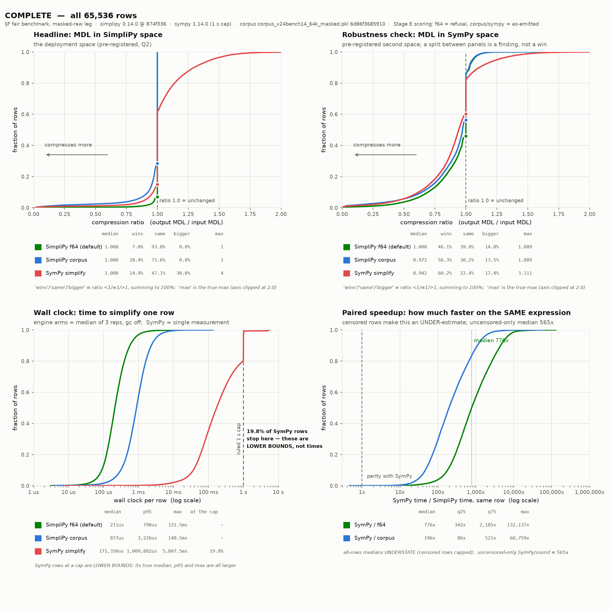

# Simplifying expressions

```python
import simplipy as sp

engine = sp.SimpliPyEngine.load("acj-5-4-llm", install=True)
```

## The pipeline

```text
function simplify(expr, max_passes=48, mode=strict, effort=DEFAULT_EFFORT):
    state = canon(parse(expr))            # infix→prefix or validate, then the CANONICAL
                                          # form: flat AC bags, exact rationals, like
                                          # terms collected — this is state ZERO

    loop:                                 # a DETERMINISTIC chain, no search
        next = canon(rewrite_pass(state, mode))   # one rules pass, re-canonicalized
        if next == state: break           # fixpoint
        state = next
    return state                          # μ(state) ≤ μ(state zero): every changed pass
                                          # output strictly descends the well-founded
                                          # reduction ordering, so termination is a
                                          # THEOREM; max_passes and the step cap are
                                          # defence-in-depth, not the mechanism
```

Every step preserves the function almost everywhere: like-term collection inside the
canonical constructors, rule application, and the exact fold. The result is therefore
sound, never costlier than the input in the measure the chain itself descends — each
mode's own canonical pricing — and idempotent at any fixpoint run. `complexity(e,
mode=m)` is that measure: each mode reads an expression into its own canonical form,
because the modes accept different simplifications as true (`strict` follows the float
evaluator, so `atanh(tanh(x))` is not `x`, as `tanh` saturates to `1` in floats; `permissive`
follows the reals, so it is, and also what holds only up to sign or domain, so `(x^2)^(1/2)`
is `x`, where `strict` gives `abs(x)`), and prices
that form. So
`complexity(simplify(e, mode=m), mode=m) ≤ complexity(e, mode=m)` in every mode, and
prices of different modes are prices of different readings, not comparable across
modes. Two *different spellings* of the same value may still settle at different
fixpoints; each obeys its own bound.

The chain itself does not search: **cancellation IS canonicalization** — like-term
collection in flat bags, computed by one deterministic function, so inside a pass there
is nothing to branch over. Every changed pass output strictly descends the reduction
ordering (μ, then the canonical order), and that ordering is well-founded, so the chain
never revisits a state and reaches its fixpoint in finitely many passes as a theorem;
the `max_passes` parameter (default 48) and the internal step cap are defence-in-depth
against ordering-invariant bugs, not part of the argument. `max_passes` bounds the
number of times that `loop` body runs — **passes, not nodes**: one pass reaches the
fixpoint (it re-enters every node it changes; debug builds assert it), so the next pass
only confirms it, the default of 48 is never reached, and the knob is not a performance
dial. It must be at least 1. What strict descent alone cannot do —
pass through a state that prices *higher* on the way to a cheaper one — is the job of
the [search budget](#the-search-budget) below.
The full ledger of what is theorem, what is enforced, and what is empirical is
[formal.md](../formal.md).

**Masking is part of the same machinery.** Relabelling numeric literals to the generic
`<constant>` placeholder is a *representation* step for a downstream model that cannot
consume literals, and which literals to abstract is the caller's policy, so it is its own
call, `mask()`, never a side effect of `simplify` (see the [Masking guide](masking.md)).
It is not outside the engine, though: `<constant>` is a first-class token inside
`simplify` — rules bind it, and the exact fold collapses constant subtrees into it under
the positive-measure licence — and `mask()`'s collect stage is itself a `simplify` call
over the substituted tokens, which is what enforces one `<constant>` per degree of
freedom (`2*x0/3` is one free value, not two).

The same call as one procedure, with the memo state each stage touches noted where
it applies:

1. **Intern** the input tokens to token ids (the token store: the engine table plus a
   per-call overlay).
2. **Canonicalize** into state zero: flat AC bags, exact rationals, like terms
   collected. Cancellation lives here.
3. **Loop** — one rewrite pass over the state, then re-canonicalize; stop at the first
   pass that changes nothing (the fixpoint). Every changed pass output is strictly
   below its predecessor in the reduction ordering. Inside the pass, per subtree,
   top-down:
    1. exact rule lookup; on a miss, the pattern scan, most specific pattern first (the
       most nodes beyond one per placeholder; file order among equals), first match wins;
    2. a match that binds wide slots must pass the bind-time `!`/`$` certificates
       (skipped in permissive mode); verdicts are memoized per call and in a
       generational per-engine cache;
    3. no match: the exact fold with the `<constant>` collapse (positive-measure
       licence; relaxed in permissive mode);
    4. still nothing: recurse into the operands and re-check the rebuilt node.
4. **Serialize** back out: μ ≤ input, sound, idempotent. Callers that need
   placeholders then run `mask()` — the separate call above.

The compiled core implements one engine line: numeric constant folding (including
non-finite results such as `1/0 -> float("inf")`) and real-semantics power evaluation.

## The written price

`complexity(e, mode=m)` prices what an expression *is* in a mode: its canonical state.
`written_complexity(e)` prices what was *written*: the same code book (the symbol table, the sign
bit and the literal code, in milli-bits) applied to the expression exactly as written. It takes no
mode and no certificate, because nothing is read into a state and nothing is simplified: every
operator, function, variable, sign and number written is charged. The only identifications are
the ones infix notation forces, and where the notation leaves a choice, the reading is the one
the code book prices:

- a run of `+` and `-` is one sum, and a run of `*` and `/` one product, whatever the bracketing:
  a left operand and a `+` (`*`) operand continue the run, a bracketed subtrahend or divisor stays
  whole, and operands are unordered; a call of `max` or `min` with more than two arguments,
  `max(a, b, c)`, is one call and pays its head once (`max(max(a, b), c)` writes two calls);
- `-y` and `neg(y)` are a sign, one bit; a written `-inf`, and `inf` as a subtrahend, is the
  symbol `float("-inf")`, 8 bits;
- `1/y` is the reciprocal of `y` (the 1 is the notation's) and `inv(y)` is the same, and `-1/y`
  is the sign of the reciprocal, `-(1/y)`; dividing by a written power `y^k` is `y^-k` when `k`
  is a number, the division's sign merging into it (`x/y^-2` holds `y^2`), and the reciprocal of
  the power otherwise (`x/y^z`); dividing by a number, `x/3`, holds the literal 1/3, as
  `complexity` prices it;
- a number pays the literal code on the exact value written, every digit (a long literal is not
  rounded to its double); a quotient of two integer literals written directly, `p/q`, is one
  literal, the number p/q, as `1/q` and `0.75` are, while numbers written apart in a product pay
  apart (`4*x0/3`, `2*x0*3`) — this reading of `p/q` awaits the owner's ruling, and as a division
  `3/4` would cost 10.322 bits; `np.pi`, `np.e`, the infinities, NaN and the constants
  `<constant>` and `<constant_NAME>` are priced as `complexity` prices them;
- an alias is priced as its target, and a defined function (see
  [Defined functions](artifacts.md#defined-functions)) pays its own head at the tier of the
  function its definition applies: `sqrt`, `cot`, `sec` and `csc` 6 bits, `acot`, `asec` and
  `acsc` 8. Any other head the engine neither declares nor defines is refused.

| expression | written (bits) | `complexity` (bits) |
|---|---|---|
| `x0 + 0` | 11 | 6 |
| `x0*x0` | 15 | 11.585 |
| `exp(1)` | 8 | 4 |
| `-(x0 - x1)` | 17 | 16 |
| `sqrt(x0)` | 12 | 14.585 |
| `x0**0.5` | 12.585 | 14.585 |
| `x0 - x0/1 + 2` | 23.585 | 2.585 |
| `-1/x0` | 10 | 10 |
| `-inf` | 8 | 8 |
| `x0/x1**x2` | 27 | 27 |
| `max(x0, x1, x2)` | 26 | 26 |
| `3/4` | 5.322 | 5.322 |
| `x0**(3/2)` | 13.585 | 13.585 |
| `4*x0/3` | 16.322 | 14.322 |
| `6.674e-11*x0*x1/x2**2` | 45.197 | 45.197 |
| `x0*x1/(4*np.pi*x2*x3**2)` | 45.907 | 47.907 |

The last row shows that neither price bounds the other: the canonical form distributes the
reciprocal of a product (`x0*x1/4/pi/x2/x3^2`), which costs one reciprocal per factor where the
written bracket pays one reciprocal and one product head.

```python
engine.written_complexity('x0 + 0')                    # -> 11000
engine.written_complexity('exp(1)')                    # -> 8000
engine.written_complexity('-(x0 - x1)')                # -> 17000
engine.written_complexity('x0**0.5')                   # -> 12585
engine.written_complexity('x0 - x0/1 + 2')             # -> 23585
engine.written_complexity('6.674e-11*x0*x1/x2**2')     # -> 45197
engine.written_complexity('x0*x1/(4*np.pi*x2*x3**2)')  # -> 45907
engine.complexity('x0*x1/(4*np.pi*x2*x3**2)')          # -> 47907
```

On a canonical form written as its state is held — one run per bag, one divisor per reciprocal,
each sign where the state holds it — the two prices agree, but that is measured, not promised:
the canonical *serializations* write some states otherwise. Over the census's canonical answers
(31,993 per mode: srbf's 6,531 ground truths and a tenth of flash-ansr's training inputs and of
srbf's predictions), the written price of the answer equals `complexity`:

| answer | `strict` | `permissive` |
|---|---|---|
| infix print (`simplify(str)`) | 30,312 (94.75%) | 30,197 (94.39%) |
| prefix tokens | 29,571 (92.43%) | 29,544 (92.35%) |

Every difference is the serializer's (an answer can show more than one cause):

- **N2**, a negation distributed over a sum: the printers write `-(x0 + x1)` as `-x0 - x1` (17
  bits written, 16 canonical); 1,617 and 1,668 infix prints, 761 and 770 prefix answers;
- a coefficient p/q printed `p*x/q`, its numbers written apart (`4*x0/3`, 16.322 against 14.322);
  60 to 69 answers per mode and form;
- **G**, in the prefix tokens a product of reciprocals written as the reciprocal of a product
  (`inv * x0 x1`, 18 against 21); 1,108 and 1,114 prefix answers, and 1 and 38 infix prints;
- **N1**, in the prefix tokens a sign on a product inside a product (`/ neg * x0 x1 x2`, 28 against
  25; the infix print `-x0*x1/x2` agrees); 563 and 542 prefix answers;
- **D**, an answer printed factored that `complexity` reads distributed; 2 to 91 answers per mode
  and form.

(Counts are `strict`, then `permissive`.)

## The search budget

Strict descent cannot cross a μ-hill. `x2*(x2 + (x1+1)/x2)` reaches the strictly
cheaper `1 + x1 + x2**2` only by distributing first — which prices *higher* at that
node — and recollecting after, so the chain above, which only ever takes descending
steps, never finds that valley. The search budget exists for exactly this class.

With a budget, the chain first runs unchanged to its fixpoint. An exploration
phase then proposes the moves of the distributive law the descent refuses — distributing a
product over its sums (or one factor into a sum factor, or the other factors over one term of
it), expanding an integer power of a sum, and factoring what some terms of a sum share out of
exactly those terms — runs every candidate through the same certified constructors and the
same descent loop, and replaces the incumbent only when the candidate's endpoint lands
strictly below it in the engine's one reduction ordering. Acceptance is that ordering test
and nothing else; no new measure or tolerance enters. No rule states the law: factoring has
several answers (`x1*x2 + x1*x3 + x2*x4` factors two ways) and which one pays depends on the
whole expression, so the search owns it, in every mode alike, and `effort=0` does not factor.
Each move is a law of the catalogue with its own premise (`search.distribute`,
`search.pow_expand`, `search.factor`, `search.reciprocal_join`): the two sides of the law differ
only where a piece it multiplies into two or more terms, or collects out of them, is infinite, so
in `strict` such a piece is infinite only at points and may have no value on a region
(`x1*sqrt(x0) + sqrt(x0)` is `sqrt(x0)*(x1 + 1)`), and a pole two or more terms keep is split
only where each of those terms carries two-signed poles only, the sign of its infinity an isolated
zero's, no value kept, or where they take one strict sign there: `(x1 + x2)/abs(x0)` stays, `+inf`
at `x0 = 0` where `x1 = x2 = 1`, whose split is NaN wherever `x1` and `x2` differ in sign, and so
does `(1/x0 + x1)^2 - x1^2`, `+inf` at `x0 = 0`, where `1/x0^2 + 2*x1/x0` is NaN for `x1 < 0`.
`(x1 + x2)/x0 - x2/x0` is `x1/x0` in one factoring. `permissive` reads no value at a pole.

The chain takes a step that rises at its node where the whole expression's price falls, the
price not being monotone in a part's (a cheaper part can make the expression around it dearer,
and the reverse); a rebuild that rises in the whole too is proposed to the search as the state it
builds (the composite step), and kept where that state's descent ends cheaper.

The budget is the `effort` parameter. The default, `effort=None`
(`simplipy.DEFAULT_EFFORT`), searches until a round finds nothing, so a second call
has nothing left to continue. `simplify(expr, effort=64)` caps the search at 64 candidate
descents, and `effort=0` never enters the phase — byte-identical to the chain alone. Pass
`effort=0` on throughput-critical paths.

A cap counts every candidate tried, refused ones included, over the whole expression, so
the cap a search needs grows with the expression: one of srbf's model predictions needs 5
candidates to reach its uncapped answer, a sum of two copies of it 10 and of six 30, so no fixed
cap is enough. Capped at 4, the old default, 1,632 of srbf's 125,127 model predictions change on
a second call in `strict`, every one to a cheaper form, because the first call stopped
between two improvements. Uncapped, none does in `strict`, on any of the three sets. On
the predictions no answer is costlier than at cap 4 and 1,633 are cheaper. The search is one
walk: it rebuilds each candidate of the current answer into the whole expression it makes,
tries them cheapest first, steps to the first whose descent ends cheaper than the current
answer, and stops when a whole round finds nothing; `effort=k` is the first `k` descents of that
walk. A round tries a sum's pairs of terms only once every other move found nothing: their count
grows with the square of the terms, and a factor every term shares goes first
(`x0*x1 + ... + x0*x64` factors `x0` out in 13 ms, where reading its 2,016 pairs took a second;
past 64 terms the pairs are not read, and a longer sum still factors what all its terms share). On srbf's predictions it spends 15% more matcher steps and constructor calls than
`effort=4` in `strict`. Every internal caller that passes no
`effort` (normalization, masking, mining, the verification monitor, the promotion refund)
follows the default.

`permissive` is one walk, like every mode: its chain to a fixpoint, then the search, in its own
canon and rules. No constructor folds a transcendental, so a constructor identity always
sees the shape it reads (`atanh(tanh(30))` is `30`); its ground fold is a step of the chain,
tried after the rules at each node and kept only when it is cheaper, as in `strict`. It takes the
table's value in the reals, written as the double nearest to it, where `strict` computes the
deployed evaluator's (`asin(1e-8)` is `1e-8` in both; `exp(9.55893790547399)` is
`14170.787488305128`, where `strict` gives `14170.787488305119`), and like `strict` it reads a whole
ground node before its parts (`rootn(exp(19.11787581094798), 2)` is `14170.787488305128`, not the
root of `200811218.03870487`). Its literals are exact and rounded once, where
they land: a literal that becomes a constant term, a coefficient, a function's argument or a
power's operand beside a non-literal moves to whichever of the two floats around it prints
shorter, when that spelling is cheaper (`3*(1/3 + 1e-20)` is `1`, `x1*0.0766…` with 64 digits is
`0.07665412684716773*x1`, and `4/(2.7167019109484434*3.1415926535897)` is `0.4686710527952964`,
not the nearest float's `0.46867105279529636`, which `strict` writes). Its search has one move of its own, joining reciprocal sums
(`c/(A*B)` is held as `c * A^-1 * B^-1`, and the move proposes `(A*B)^-1` and `(A/c)^-1` with the
inside distributed). So, as in every mode, its answer never prices above the input or above its
answer at a smaller `effort`, and a second call returns it unchanged.

<!-- TO BE RE-MEASURED after the re-mine: this paragraph was measured before the search took
     over the distributive law and before permissive became one walk (permissive then: mean ratio
     0.961 -> 0.950, strictly simplified 21.2% -> 33.9%, about 64% more median time). -->
What the search buys, on the 129,490 simplify inputs of flash-ansr's training-data generator
(output price over input price, `complexity(.., mode=m)`): in `strict` it moves the mean ratio from 0.979
with the search off to 0.972 and lifts the strictly simplified answers from 5.7% to 13.5%, for
about 30% more median time per call.

Every guarantee above survives any budget: candidates are built under the same
certificates (soundness), the incumbent is only ever replaced by something strictly
below it (the result is never worse than the fixpoint, hence never costlier than the
input), both
phases move only on strict descent of a well-founded ordering
(termination, independent of the budget), and the walk order is deterministic
(reproducibility). Idempotence needs the search to run
until a round finds nothing, the default in every mode: a cap can stop it
between two improvements, which a second call then continues.

## Named constants

`<constant>` is a fitted constant, and every occurrence is an independent one. A **named
constant**, `<constant_NAME>` with NAME letters and digits, is one unknown finite real shared
by every occurrence of its name; distinct names are independent. All three dialects read it,
infix text included.

- A name the expression uses **more than once** is read as a variable, in both modes: every
  answer holds for every value, and the name is never folded with numbers.
- A name used **once** is exactly a `<constant>`: it is absorbed as one, and the answer writes
  it with its name. Where fitted constants become one, the one keeps a name if any of them had
  one, the least in string order. A name the answer uses once is read as a fitted constant too,
  so an answer simplifies to itself.
- The complexity measure prices a name as a `<constant>` at every occurrence, however often the
  expression uses it, so an answer never prices above its input.

```python
engine.simplify('<constant_a>*x1 + <constant_a>*x2 + x3')   # -> 'x3 + <constant_a>*(x1 + x2)'
engine.simplify('<constant_a>*x1 + sin(<constant_a>)')      # -> 'sin(<constant_a>) + <constant_a>*x1'
engine.simplify('sin(<constant_a>)')                         # -> '<constant_a>'
engine.simplify('<constant_b> + 3.7*<constant_a>')           # -> '<constant_a>'
engine.simplify('exp(<constant_a>) + exp(<constant_a>)*x1')  # -> '<constant_a>*(x1 + 1)'
```

A name is a parameter, not a variable, everywhere else too: `expression_variables` leaves it
out, `evaluate_constants` folds no part that holds one, `as_code` and `as_callable` bind one
parameter per name after the variables (written `constant_NAME` in the code), the
code-generation helpers give all occurrences of a name one identifier and one value, and
masking never masks it (see the [masking guide](masking.md#named-constants)). The canonical
order compares names last, so renaming the constants consistently changes no choice between
parts that differ in more than their names.

## Soundness modes

`simplify(expr, mode=...)` selects a point on an **axis**, not a rung on a ladder.
`simplipy.Mode` has two members: `strict` (the default) and `permissive`. The `real` mode is
retired: naming it raises, and its values in the reals are what `permissive` reads.

The axis exists because soundness is two *incomparable* notions, not one ordering. A rewrite
can be true in mathematics and not reproduced by floating point, or reproduced exactly by
floating point and mathematically false:

| rewrite | true over ℝ? | what float64 computes |
|---|---|---|
| `atanh(tanh t) → t` | yes, for every real `t` | `inf` once `tanh t` rounds to exactly `1.0` — from `t ≈ 19.06` on the release host; the exact threshold is libm-dependent |
| `asin(1e-8) → 1e-8` | no — wrong by the cubic term, `1.667e-25` | bit-identical |

Neither rule is "more sound" than the other, so there is no rung to put them on, and `<`
between modes raises `TypeError`. The rule sets are nested all the same: `permissive` includes
`strict`. Every rule that holds in `strict` holds in `permissive`, which serves it with its own
matcher and promises for that step what `strict` promises; `permissive` adds the rules true in the
reals at float resolution and its own simplifications.

- **`Mode.strict`** (the default) is sound as the deployed float64 evaluator computes, wherever no
  operation overflows or underflows. Use it whenever the output will be evaluated in floating
  point. Where an operation overflows or underflows, an answer may hold the evaluator's value
  there or the true one: `log(exp(x0))` is `x0`, where float64 computes `inf` past x0 = 709.78 (see
  [What `strict` mode does and does not promise](#what-strict-mode-does-and-does-not-promise)).

- **`Mode.permissive`** is for training-corpus canonicalisation ("beautification"). It
  includes `strict`: every rule that holds in `strict` holds in `permissive` too. Its promise is per
  rule:
  every rule it applies agrees with the reals' values up to float resolution (8 units in the
  last place), or gives a value where its input has none, or holds in `strict`. A whole
  answer carries no such bound: rounding-sized differences compose over the steps, and
  `floor`, `ceil` and cancellations magnify them (`floor` of a value one unit in the last place
  below an integer is a whole unit off). Every rule placeholder binds any subtree (the `!`-certificate is skipped), cancellation drops
  its group-axiom gate, the constant-fold drops its finiteness gate, and an exact literal whose
  fraction prices above the shortest float spelling of its value folds to that float (the
  quotient of two 16-digit decimals becomes `0.46867105279529636` instead of a 60-digit
  fraction; `1/2` and `15/37` stay, being cheaper as fractions). It is *not*
  equivalence-preserving. Do not use it on an inference or scoring path: the training data is
  generated *from* the simplified form, so the target equals the data and there is no external
  function to violate.

Both modes write a number a sum's terms share once: its terms are grouped by the exact value of
their coefficient up to sign, and each group of two or more is written `c*(group)`, the sign in
the coefficient, where that costs no more than its terms distributed, so a masked answer
abstracts a shared inexact number into one `<constant>`; an exact number whose group costs more
stays distributed. The key is the exact value, so the grouping is deterministic and does not
depend on how the sum was built; with the whole sum as the group it is the content every mode
takes out. A coefficient of magnitude one is no number to share, and a term holding a fitted
constant keeps its own. In `strict` each group is the factoring of a whole sum, which float64 only
rounds otherwise (`c*a + c*b` against `c*(a + b)`), with that factoring's premise: a sign leaves
a group only where nothing reads the zero of the group's sum. Where two spellings of a sum then
cost the same in `permissive`, the one `strict` prices lower is taken, so a permissive answer is
never dearer than `strict`'s on `strict`'s yardstick. `prettify` displays the groups.

```python
engine.simplify('3.71649*(x1 + x2) + x3')                           # -> 'x3 + 3.71649*(x1 + x2)'
engine.simplify('3.71649*x1 + 3.71649*x2 + x3', mode='permissive')  # -> 'x3 + 3.71649*(x1 + x2)'
engine.simplify('2*x1 + 2*x2 + 4*x3 - x4')                          # -> '4*x3 + 2*(x1 + x2) - x4'
engine.simplify('-3.71649*x1 + 3.71649*x2 + x3')                    # -> 'x3 + 3.71649*(x2 - x1)'
```

The canonical form reads like a law, in both modes: a quantity's own powers are never nested.
A product of a sum with a factor that reappears in it, itself or the base of one of its powers,
as a multiplicative factor of a term, is multiplied out (the reappearing factors only), and the
search takes no move that nests one. A factor that does not reappear inside is taken out;
products and powers of sums stay products, and a quotient by a power keeps the form it comes in.
The step is the distributive law with its `strict` premises, in both modes; where they refuse it,
the product stays.

```python
engine.simplify('x1*(x1*(0.4*x1 + 2.7) + 1.3)')   # -> '1.3*x1 + 2.7*x1^2 + 0.4*x1^3'
engine.simplify('x1^2 + 3*x1 + 2')                 # -> '3*x1 + x1^2 + 2'
engine.simplify('x1*(x2 + x3) + x4')                # -> 'x4 + x1*(x2 + x3)'
engine.simplify('2*x1*(x1 + 1)')                    # -> '2*(x1 + x1^2)'
```

### How numbers are printed

Every literal is its exact rational value (`0.1` is 1/10), and arithmetic between numbers is
exact. A number is then written as the cheapest value its mode admits, and costs what its
written spelling costs: `strict` writes float64's double where that is cheaper than the exact
value, and the exact value where it is not; `permissive` writes the exact value or one of the
two doubles around it.

```python
engine.simplify('x0*0.30000000000000004*0.30000000000000004')  # -> '0.09000000000000002*x0'
engine.simplify('0.1 + 0.2')                                   # -> '0.3'
```

A literal that float64 reads as exactly the double of a short symbolic number is that number:
`k*pi/m` and `k*e/m` (k and m coprime, m at most 24), a fraction `k/m` with no finite decimal
(m at most 24, at most 100 in size), `log(2)`, `log(3)`, `log(10)`, `sqrt(2)`, `sqrt(3)` and
`sqrt(5)`, with either sign. The same list spells an answer's numbers, so an answer reads back
as itself:

```python
engine.simplify('6.283185307179586*x0')       # -> '2*pi*x0'
engine.simplify('0.3333333333333333*x0')      # -> 'x0/3'
engine.simplify('x0 + 0.6931471805599453')    # -> 'x0 + log(2)'
engine.simplify('1/(2*3.141592653589793)')    # -> '1/2/pi'
```

A value whose denominator has a prime factor other than 2 and 5 has no finite decimal. Where
its reciprocal terminates and its denominator is above 24, its price is that reciprocal, written
as the divisor in every dialect: `1/(2*3141.592653)` is `1/6283.185306`. Otherwise its price is
the fraction: `7/(2*3141.592653)` is 3500000 / 3141592653. A decimal is just as exact as an
integer, though, so the infix answer prints such a fraction with its numerator's factors 2 and
5 moved into the denominator, which then terminates. That spelling needs a factor 2 or 5 in the
numerator and is used where it is shorter than the two integers, outside exponents: short
fractions such as `1/3` keep theirs, and an exponent keeps the fraction
(`x0^(3500000/3141592653)`). It is the one spelling written for a reader alone: every other
number, in every dialect, is written by the codeword it is priced at. It is the same value
either way, so the state, `complexity()` and every rewrite are unaffected:

```python
engine.simplify('7/(2*3141.592653)')                  # -> '7/6283.185306'
engine.simplify('7*x0/(20*3141.592653)')              # -> '7*x0/62831.85306'
engine.simplify('x0*rootn(7*x1/(2*3141.592653), 2)')  # -> 'x0*rootn(7*x1/6283.185306, 2)'
engine.simplify('1/(2*3141.592653)')                  # -> '1/6283.185306'
engine.simplify('5/8')                                # -> '5/8'
```

The token answers keep the fraction (explicit `['/', '3500000', '3141592653']`, tagged
`['<mul>', '3500000', '<div>', '3141592653', '</mul>']`): the engine prints states as tokens and
reads them back, and callers mask and compare token answers, so one fixed spelling serves
them.

Each mode names one **distinct, complete** rule set — `rules_strict.json` /
`rules_permissive.json` (a config may name the strict file `rules.json`, as artifacts before 0.15
did) — so selecting a mode selects a file, and what is loaded is what is served.

```python
from simplipy import Mode

# A fitted constant owes a value only where its expression is finite: log(C) is finite on
# C > 0, so every mode reads exp(log(C)) as a fitted constant. (-1)^C is finite only at the
# integers, which no fit lands on; the default keeps it, the permissive mode collapses it.
engine.simplify('exp(log(<constant>))', mode=Mode.strict)  # -> '<constant>'
engine.simplify('(-1)^<constant>', mode=Mode.strict)       # -> '(-1)^(<constant>)'
engine.simplify('(-1)^<constant>', mode=Mode.permissive)   # -> '<constant>'

# sqrt(x^2) is |x| over the reals; the permissive mode takes the sign-ignoring
# algebraic collapse instead:
engine.simplify('rootn(x0^2, 2)')                          # -> 'abs(x0)'
engine.simplify('rootn(x0^2, 2)', mode=Mode.permissive)    # -> 'x0'

# A finite-a.e. subtree (pole at a single measure-zero constant) folds in every mode:
engine.simplify('1/<constant>')                            # -> '<constant>'
```

The two modes disagree on a single expression where float64 saturates:

```python
engine.simplify('atanh(tanh(30))', mode=Mode.strict)      # -> 'inf'   what float64 computes
engine.simplify('atanh(tanh(30))', mode=Mode.permissive)  # -> '30'    what is true
```


### What `strict` mode does and does not promise

**Every rule it applies** has been checked against the deployed evaluator itself. Both sides
of the rewrite are evaluated in floating point across the verifier's battery and grid, and a
rule enters the `strict` set where they agree to within 8 ULP, or where the rule is true in the
reals wherever they give both sides a value and the two floating-point sides agree in kind --
both finite -- at every such point, and within 8 ULP at every other point. The 8 ULP are derived rather than chosen: a rewrite has two sides, each a
composition of up to four implementation-defined library calls whose errors are independent
and can oppose. The second reading admits the identities float64 only rounds: `sin(x0 + pi)`
is `-sin(x0)` in the reals, and float64's two sides differ by its rounding of `x0 + pi` (at
x0 = 0, 1.2e-16 against -0), as `floor(x0 + 1)` and `floor(x0) + 1` differ at x0 = -1e-17
(1 against 0). A zero's sign counts where it changes a value on a region: a rule whose sides
float64 makes zeros of opposite sign there (`0*asin(x0)` and `0*acos(x0)` for x0 < 0), or whose
one side turns on a zero's sign that the other does not read (`atan2(0*x0, -1)` against `pi`),
is not in the `strict` set; one whose sides differ at an isolated point only (`log(exp(x0))` and
`x0` at x0 = -0) is. So a rewrite keeps float64's kind of every value, and agrees with float64's
evaluation of its input within rounding, except where a jump or a pole lies between float64's
argument and the real one.

Overflow and underflow are a special case. An operation overflows when its operands and its
exact value are finite but its float is `±inf` (`exp(800)`), and underflows when its exact
value is nonzero but its float is zero or subnormal (`exp(-800)`). At a point where an
operation of either side does, a rewrite may give the true value instead of the evaluator's,
which is what the canonical constructors have always done:

```python
engine.simplify('exp(x0)/exp(x0)')        # -> '1'    (inf/inf is nan in float64 past x0 = 709.78)
engine.simplify('x0*x1/x1')               # -> 'x0'   (x0*x1 can overflow first)
engine.simplify('rootn(exp(800.5), 2)')   # -> 'exp(1601/4)'
```

A pole is not an overflow (`atanh(1)` and `log(0)` are infinite exactly), and saturation is
not one either: `tanh(20)` is exactly `1.0` in float64 without leaving the range, so
`atanh(tanh(x0))` keeps the evaluator's `inf` and `strict` does not rewrite it to `x0`. Where `|x|`
is shown at most 19, short of that, it does: `atanh(tanh(19*sin(x0)))` is `19*sin(x0)`.

It does **not** promise that a *sequence* of rewrites carries the same bound. Each rule
carries it individually; simplification composes rules, and floating-point error composes
with them.

A step cap bounds each call (10^6 accepted rewrite steps). It is a resource limit, not
proof of a bug: a valid terminating descent can take more steps (a chain of n rules can take
2^n - 1 of them). When it binds, rewriting stops at a state reached by sound steps, which may
not be minimal, and the call says so: `simplify(x, return_status=True)` returns the answer with
a `SimplifyStatus` whose `interrupted` is true and whose `caps` names the cap that bound
(`'steps'`; `'max_passes'` where the passes ran out before one confirmed the fixpoint, and
`'effort'` where the search budget ran out with candidates left). The process-wide count of
step-cap bindings stays readable (`engine._core.step_cap_binds()`).

**The float64 realizations.** `strict` means the shipped realizations, `simplipy.operators`, each the
core's float64 kernel, so the deployed value, the constant fold, the miner and the rule judge
compute the same bits. Where they differ from numpy, they differ by name:

| operator | realization | difference from numpy |
|---|---|---|
| `+`, `-`, `*`, `/`, `neg`, `inv`, `abs`, `floor`, `ceil` | IEEE 754 arithmetic | none |
| `exp`, `log`, the trigonometric and hyperbolic functions and their inverses, `erf`, `atan2` | the platform's libm, as Python's `math` computes them | none where numpy uses the same libm |
| `pow` | C's `pow`; a negative base under a non-integer exponent is NaN | at the exponents numpy computes without `pow` (`x*x` at 2, `1/x` at -1, `sqrt` at 0.5) the value is numpy's `array ** scalar` |
| `mod` | numpy's floored remainder, the divisor's sign | none |
| `max`, `min` | IEEE 754-2019 maximum and minimum: NaN if either operand is, and `max(-0, +0) = max(+0, -0) = +0` | `np.maximum` and `np.minimum` return their second operand at a zero tie |
| `rootn` | the package's own kernel, IEEE 754 `rootn` | numpy has none |
| `harmonic` | the package's own kernel, within 0.53 ulp on x > -1 | numpy has none |
| `besselj` | the package's own kernel, scipy 1.18.1's `jv` code | numpy has none; against `scipy.special.jv`, measured on the development host (Linux, glibc 2.43): 0 of the 167,361 points of the repository grid differ, and another host measured 65 of them apart, by at most 30 ulp. Its complex product and quotient are the core's own, GCC's runtime's algorithms, the same on every platform; where a platform's scipy divides complex numbers with another routine (LLVM's on macOS; Ubuntu 26.04's libgcc rounds some quotients one unit in the last place apart), the values differ from that scipy in the last bits ([environment qualification](../method/environment-qualification.md)) |
| `erfc`, `besseli` | the package's own kernels, scipy 1.18.1's `erfc` and `iv` code (Cephes) | numpy has none; against `scipy.special.erfc` and `scipy.special.iv`, measured on the development host (Linux, glibc 2.43): 0 of 1,594,018 and 0 of 1,318,385 points differ |
| `bessely`, `besselk` | the package's own kernels, scipy 1.18.1's `yv` and `kv` code (AMOS, and Cephes for `yv` where AMOS gives up) | numpy has none; against `scipy.special.yv` and `scipy.special.kv`, measured on the development host: 0 of 1,258,385 and 0 of 1,318,385 points differ. Their complex arithmetic is `besselj`'s, and so is their difference from another platform's scipy ([environment qualification](../method/environment-qualification.md)) |

It does **not** promise to preserve your evaluation order. The canonical form flattens sums
and products into bags and re-emits them, and IEEE-754 addition commutes but does not
associate:

```python
engine.simplify(['+', '+', 'x0', 'x1', 'x2'])   # -> ['+', 'x0', '+', 'x1', 'x2']
# at x0=1e16, x1=-1e16, x2=1 the input evaluates to 1.0 and the output to 0.0
```

The association is deterministic — the same input always gives the same output — and for
expressions that are well-conditioned in float64 the value is preserved. For ill-conditioned ones
it may not be. This is the standard position for any AC-normalising simplifier, and it is
stated here rather than left to be discovered.

**Why two modes, and how flash-ansr uses them.** The downstream trainer
([flash-ansr](https://github.com/psaegert/flash-ansr), a transformer for symbolic regression)
uses each mode on a different side of its pipeline:

- **Training-data generation uses `Mode.permissive`.** A skeleton is permissive-simplified and the numeric
  data is then generated *from that simplified form* — so the target the model learns and the data
  it is trained on are the *same* expression (`target == data`). There is no external ground-truth
  function for `permissive` to violate, so the aggressive reductions are safe here and they give the model
  the shortest, most canonical target. (A `(-1)^<constant>` that survives cancellation, for
  instance, becomes a plain `<constant>`, which is what the generated data reflects.)

- **Inference and recovery scoring use `Mode.strict`.** At test time the data comes from an unknown
  true function; the predicted skeleton must be simplified *without* changing what it computes, or
  the fit and the score would drift, and the data is evaluated in floating point -- which is
  exactly the soundness `strict` preserves.

That split is the whole reason the permissive mode exists: `permissive` maximizes canonicalization where the
simplified form *defines* the data, and `strict` preserves what the evaluator computes where
it must not change.

## Key components

- **Parsing & normalization** – `SimpliPyEngine.read_infix` and
	`SimpliPyEngine.convert_expression` convert infix input, harmonize power
	operators, and propagate unary negation without losing prefix fidelity.
- **Canonicalization (cancellation lives here)** – the canonical constructors keep
	every associative-commutative operator as a flat bag with exact rational
	arithmetic and collect like terms as they build, so opposite-parity subtrees and
	redundant factors cancel *by construction*, before and between rule passes, and
	identical expressions share identical layouts under the stable canonical order.
- **Rule execution** – `SimpliPyEngine.compile_rules` syncs machine-discovered or
	human-authored simplifications into the compiled core, which performs fast
	top-down rewriting in each pass, the most specific matching rule first.
- **Rule discovery workflow** – `SimpliPyEngine.find_rules` explores expression
	space natively on the compiled core (parallelized across all cores via rayon),
	confirms identities with numeric sampling, and writes back deduplicated
	rulesets that future engines can load instantly.

## Normalization helpers

Besides the engine, SimpliPy exports the two canonical expression FORMS at the
package root: `to_skeleton`, `to_expression`, and the single-token helper
`normalize_variable_token` (also available as `simplipy.normalization`). They
canonicalize an expression so that two expressions that are "the same" up to
variable renaming / constant values compare equal, giving downstream consumers
(holdout matching, symbolic-recovery scoring) identical behavior by construction.
Each takes all three forms (infix `str`, explicit prefix, tagged) and returns the
one it was given; the canonicalization runs through the engine's internal state,
so the answer does not depend on the dialect you passed.

```python
import simplipy as sp

# Skeleton form: variables -> x{n}, EVERY numeric literal -> <constant>
sp.to_skeleton(['+', 'v1', '2.5'], engine)
# -> ['+', 'x1', '<constant>']

# Expression form: variables canonicalized, numeric values kept
sp.to_expression(['+', 'V1', '3'], engine)
# -> ['+', 'x1', '3']

# Classify / canonicalize a single token -> (normalized_token, is_variable)
sp.normalize_variable_token('X3')
# -> ('x3', True)
sp.normalize_variable_token('sin')
# -> ('sin', False)
```

See the [Normalization](../api.md#normalization) API reference for details.

## Performance

The inline phase (`simplify`, conversions, validation) runs in a compiled Rust extension
(`simplipy._core`) on interned token ids. `!`-sort certificates are memoized —
per call, and in a generational per-engine cache — so repeated match attempts cost
nothing, and the fixpoint loop memoizes whole passes and rule-normal subtrees. There is one compiled
engine line; the published ruleset artifacts are the distinguishing factor between engines,
and rule application always considers every pattern in the loaded artifact.

<!-- TO BE RE-MEASURED after the re-mine: this benchmark (table, figures and timings) was
     measured with acj-5-4-llm at effort=4, before 0.15.0. -->
The published benchmark is pre-registered: every arm runs serially on one
pinned core of an otherwise idle AMD Ryzen 9 9950X (BLAS thread caps at 1),
paired per row against SymPy 1.14.0's `simplify()` under a 1 s cap, on
three declared corpora — a symbolic-regression training prior of flash-ansr (seed 20260830,
n = 65,536), the same prior under the engine mask policy 'all'
(n = 65,536), and an external neutral problem set (SOOSE fc/nc/wc,
n = 600; every row compiles in the engine language). The engine is the
pinned acj-5-4-llm artifact: `strict` is the shipped default, `permissive` is
`Mode.permissive`, every arm at `effort=4`, the
default before 0.15.0. Scoring runs in the deployment space:
ratio = `complexity(output)` / `complexity(input)`, priced by the engine's
shipped `complexity()` instrument in the default (strict) canonicalization;
lower is better, means carry bootstrap 95% CIs, and "made bigger" is the
fraction of rows an arm inflated. SymPy is censored — a 1 s timeout, or an
output with no spelling in the engine's language — on 8,232 / 5,895 / 8
rows of the three corpora (12.6% / 9.0% / 1.3%); censored rows score
ratio 1.0 in every mean and table stat, the charitable choice, and end the
ratio ECDFs below 1. 5,689 / 5,485 / 8 rows (8.7% / 8.4% / 1.3%) hit the
cap and end the wall-clock ECDFs below 1.

| corpus | arm | mean ratio | wins | made bigger |
|---|---|---|---|---|
| SR prior, unmasked | simplipy strict (default) | **0.966** | 13.2% | **0.0%** |
| | simplipy permissive | **0.936** | **36.9%** | 0.003% |
| | sympy simplify | 1.085 | 22.3% | 45.1% |
| SR prior, masked | simplipy strict (default) | **0.998** | 1.8% | **0.0%** |
| | simplipy permissive | **0.958** | **33.5%** | **0.0%** |
| | sympy simplify | 1.068 | 18.3% | 43.2% |
| external set | simplipy strict (default) | 0.995 | 3.8% | **0.0%** |
| | simplipy permissive | 0.992 | 9.8% | **0.0%** |
| | sympy simplify | 1.006 | 26.3% | 15.0% |

The strict arm at effort 4 (the default when this was measured) made no expression bigger: 0 of
131,072 SR rows and 0 of 600 external rows. The permissive arm
minimizes its own mode's reduction ordering, which is not the default
pricing: under the table's measure it returned a form pricing above
the input on a handful of rows (2/65,536 unmasked and 0 masked). Every such output is
that mode's idempotent fixpoint; the increase enters through
mode-specific respells — exact rational folds and pole materialization
to `float("inf")` — never through an uphill rule application or search
acceptance, which are descent-gated by construction. SymPy's `simplify`
inflates 43–45% of rows on the SR-shaped corpora. Paired wall-clock on
the same rows: median
speedup **≈260× / 300× / 420×** across corpora (strict vs sympy, over rows
where sympy finished), strict medians at 70–327 µs per row against SymPy's
27–83 ms. On the external set both systems are near the fixpoint;
SymPy's wins there are dominated by number-respelling (floats rewritten
as exact rationals), not structural simplification.



Full panels: [unmasked](../assets/benchmarks/ecdf_unmasked.png) ·
[masked](../assets/benchmarks/ecdf_masked_raw.png) ·
[external](../assets/benchmarks/ecdf_external.png)
